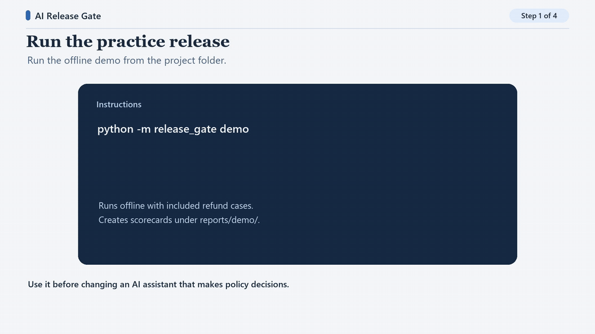

# AI Release Gate

AI Release Gate checks whether a change to a refund-triage agent is ready to merge. It evaluates the baseline and candidate on the same labeled cases, fails the CI check on regressions, and shows the order lookup and policy rule behind each failure.

<!-- portfolio-demo-videos -->
## Watch the demo

Use it before changing an AI assistant that makes policy decisions. The walkthrough has on-screen captions.



[Download the narrated walkthrough](docs/demo/how-to.mp4?raw=true) · [Download the narrated overview](docs/demo/overview.mp4?raw=true)

<!-- /portfolio-demo-videos -->

## Run the demo

Use Python 3.11 or newer. From the repository root:

```sh
python -m release_gate demo
```

The demo runs offline with no installation or API key. It writes Markdown and JSON scorecards under `reports/demo/`. The demo command succeeds when it reproduces both expected outcomes.

| Release | Result | Policy matches | Unsafe approvals |
| --- | --- | --- | --- |
| 45-day candidate | Blocked | 42/48 | 6 |
| Corrected 30-day candidate | Passed | 48/48 | 0 |

For `window-day-31`, the order lookup reports delivery 31 days ago. The 45-day candidate proposes `approve / ELIGIBLE`. The labeled 30-day policy requires `deny / WINDOW_EXPIRED`. This case blocks the release even if the aggregate score meets its threshold.

## Compare any two configurations

```sh
python -m release_gate compare --offline --baseline release_gate/examples/agents/current.json --candidate release_gate/examples/agents/relaxed.json
```

This deliberately exits with status `1`. Use `corrected.json` as the candidate to get status `0`. Status `2` indicates an input, configuration, or file error. By default the scorecard is written to `reports/comparison/`. Use `--out-dir` to change it.

Use `--dataset` for a JSONL suite and `--policy` for thresholds. The [examples](release_gate/examples/) show the complete input format. Each case has an ID, ticket, order reference, mock lookup result, and explicit expected action and reason. Label cases independently of the evaluated agent. The bundled suite covers the 30-day boundary, missing orders, unverified ownership, unsettled payments, undelivered orders, final sales, and previous refunds. Some cases exercise overlapping rules and verify which one takes precedence.

The default gate blocks any unsafe approval or execution error, a pass rate below 95%, or a drop greater than four percentage points from the baseline. Set `max_candidate_p95_ms` to enforce a latency budget when all candidate measurements are available. Rule-based runs omit model metrics. The Markdown scorecard is for review. The JSON report also carries per-case outcomes, lookup evidence, blocking case IDs, and configuration fingerprints.

## Try a local model

Start [Ollama](https://docs.ollama.com/api/chat) and make `qwen2.5:1.5b` available with `ollama pull qwen2.5:1.5b`. The included configurations use that tag. The default endpoint is `http://127.0.0.1:11434`. Override it with `RELEASE_GATE_OLLAMA_URL` if needed.

```sh
python -m release_gate compare --baseline release_gate/examples/agents/ollama-current.json --candidate release_gate/examples/agents/ollama-relaxed.json --case eligible-day-thirty --case window-day-31 --case window-day-45 --case window-day-46 --out-dir reports/live
```

This is a four-case diagnostic. Omit the `--case` flags for a full run. The model classifies structured order facts, the evaluator maps its selected reason to an action, and each action is a recommendation. The fixture lookup never changes order state or issues a refund. The model receives the structured facts, and the ticket text stays local to the supplied dataset. In live mode, latency includes the request to Ollama and can include model loading. Token totals come from Ollama.

In the verified live run, the 30-day configuration matched **4/4** cases. The 45-day configuration matched **3/4** and proposed approving the day-31 request. Replaying recordings of both configurations preserved the same blocking case.

Use `record` to capture an agent for offline CI. Run it with the same full suite CI will use:

```sh
python -m release_gate record --agent release_gate/examples/agents/ollama-current.json --output reports/current.recording.json
```

Pass the file with `--baseline-recording` or `--candidate-recording` and add `--offline`. The gate checks that the recording matches the agent configuration and contains current input fingerprints for every selected case. Review recordings like test fixtures. They preserve observations and timing from the capture, so they do not independently attest to model identity or rerun inference.

## Use the pull request check

The [workflow](.github/workflows/release-gate.yml) compares the PR's `release_gate/examples/agents/current.json` with the base commit's agent, cases, and thresholds. To try the failure path, change only `window_days` from `30` to `45` in the current rules configuration on a feature branch. The scorecard appears in the Actions job summary, and both reports are uploaded on success or failure. Restore `30` to make the comparison pass.

For a model-backed release, record the full suite and put the reviewed output next to `current.json` as `current.recording.json`. The workflow deliberately runs offline and requires a fresh recording when the agent configuration or evaluated inputs change. Configure **AI Release Gate** as a required status check in your repository ruleset to enforce it at merge time. Use synthetic or redacted cases for reports that will be shared.

## Development

```sh
python -m unittest discover -s tests -v
python -m pip install .
ai-release-gate demo
```

Installation is optional. The CLI has no third-party runtime dependencies.
